<!--
  Profile README — glass theme (Pitch Zoom glassmorphism) in the GitHub-dark / contribution-green palette.
  Ready for github.com/OUSSAMA-IKEN/OUSSAMA-IKEN — commit README.md together with the assets/ folder.
-->

  

  

  <picture>
    <source media="(prefers-color-scheme: dark)" srcset="https://raw.githubusercontent.com/OUSSAMA-IKEN/OUSSAMA-IKEN/gitascii/profiles/default/dark.svg">
    <source media="(prefers-color-scheme: light)" srcset="https://raw.githubusercontent.com/OUSSAMA-IKEN/OUSSAMA-IKEN/gitascii/profiles/default/light.svg">
    
  </picture>

  I work at the crossroads of <b>data</b> and <b>software</b>: cleaning and exploring datasets, building
  dashboards and machine-learning models that support real decisions — and shipping the full-stack web
  apps that put those insights in people's hands.

 

  

  

  

 

  

  

  

 

  

  
  

  

  

 

  

  
  
  
  

 

  

